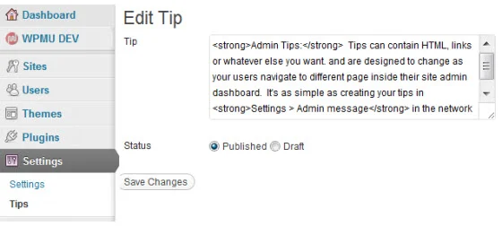
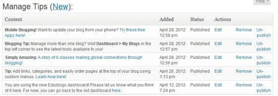
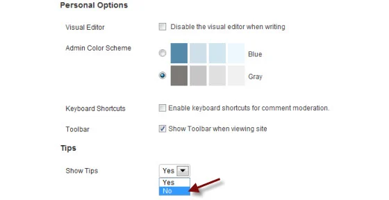

# Admin Panel Tips

**INACTIVE NOTICE: This plugin is unsupported by WPMUDEV, we've published it here for those technical types who might want to fork and maintain it for their needs.**

## Translations

Translation files can be found at https://github.com/wpmudev/translations

## Admin Panel Tips displays tips at random on the top of every page in the WordPress dashboard.

This plugin provides an effective way of sharing tips and tricks to all the registered users on a Multisite network.

### Quick Setup

Simply visit the new 'Tips' tab under Settings in the network admin dashboard to enter in as many different tips, news, promotions or whatever you choose. Tips are fully HTML compatible and give you options to edit, add to, save as draft or delete later – so you maintain complete control. 

 Add tips from an easy-to-use interface

 As users navigate the dashboard, active tips display in a random order at the top of each page. 

 Clear list manager for quick control

 Give your users the choice – allow users to toggle tips display on their profile for a cleaner user experience. 

 Let users control if tips display

### The Complete Dashboard Notification Solution

For a complete WordPress rebranding suite including the power of Admin Panel Tips check out [Ultimate Branding](https://premium.wpmudev.org/project/ultimate-branding/). Make WordPress yours from the front end to the back end.

## Usage

For help with installing plugins please refer to our [Plugin installation guide.](https://wpmudev.com/docs/using-wordpress/installing-wordpress-plugins/#installing-mu-plugins)

### To Use:

1\. Install the Admin Panel Tips Plugin. 

2\. Navigate to Plugins in the network admin dashboard and Network Activate the plugin. 

3\. Go to **Settings -> Tips** (or **Settings -> Tips** in regular WP) 

4\. Click **New** 

5\. Write your tip 

 6\. Click **Save Changes** 

